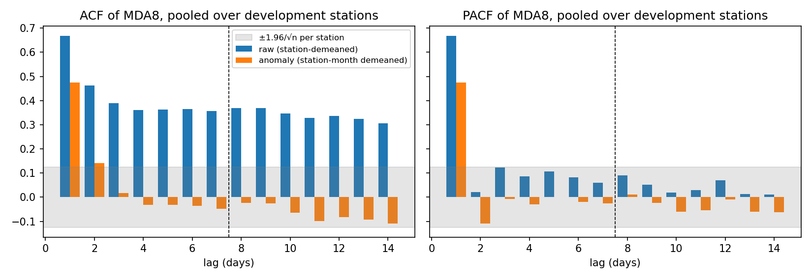
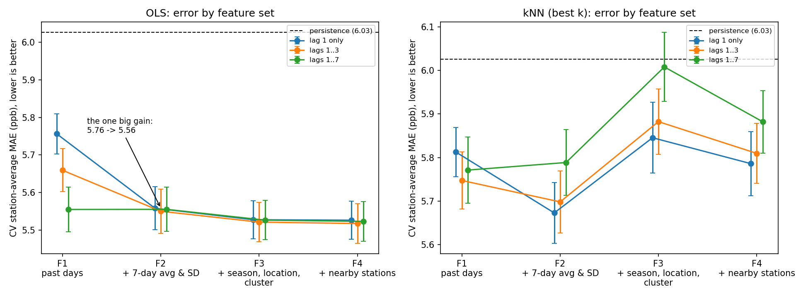
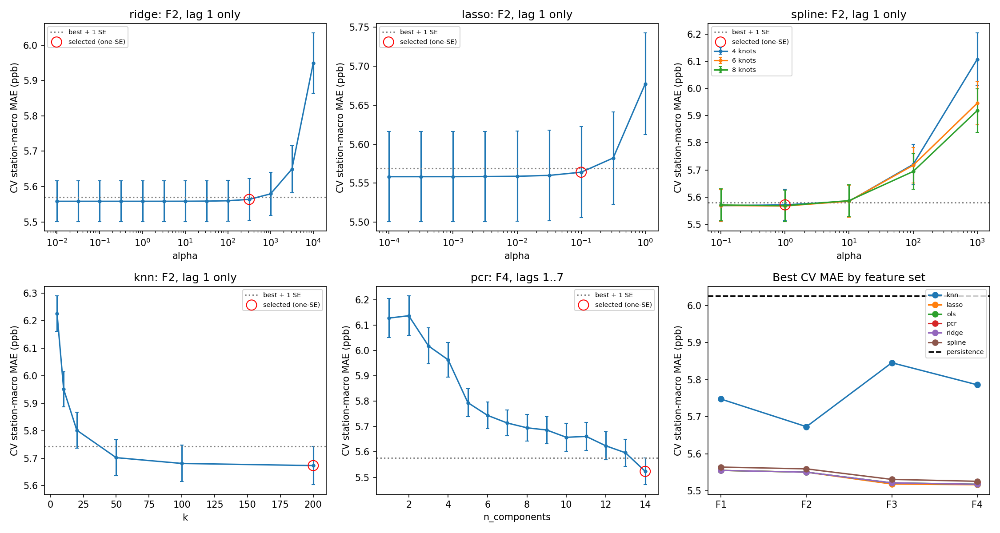
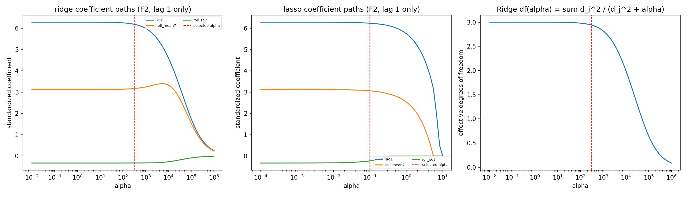
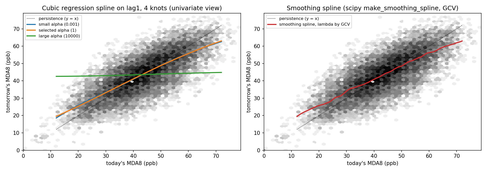
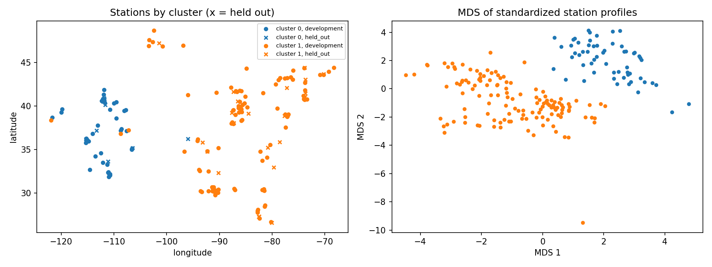
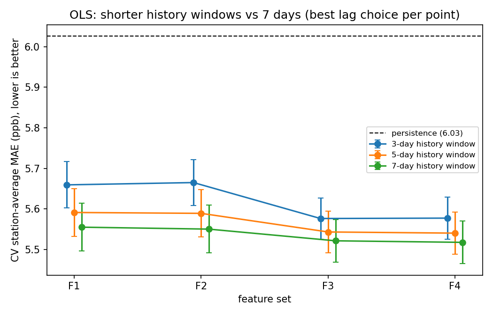

# Next-Day Ozone Forecasting: Key Findings

> **Version 1 (7-day history window).** Kept as written. Its figures and numbers are archived in `outputs_v1_7day/`. An audit found issues with the window choice and some wording; see `key_findings_v2.md` for the corrected version.

*Status as of 2026-11-06. Every number here comes from cross-validation on the training data. The one-time final test has **not** been run yet (see the last section).*

## The answer in one minute

- **A simple straight-line model (OLS) beats "tomorrow = today" by about 8%.** Its average error is 5.56 ppb, against 6.03 ppb for the baseline.
- **Three inputs are enough:** today's ozone, the average of the past 7 days, and how much ozone varied over those 7 days.
- **Fancier methods don't help.** Ridge, Lasso and splines give the same accuracy as OLS. kNN is worse. Adding season, location and nearby-station features helps only a little.
- **Ozone has a short memory, but the week's average still matters.** Beyond yesterday and the day before, single past days add almost nothing. Still, a 7-day average beats a 3- or 5-day one, because a full week gives a steadier picture of each station's current level.

---

## 1. What we did

| Item | What it means |
|---|---|
| **Goal** | Predict tomorrow's ozone at each monitoring station from that station's past week |
| **What we predict** | MDA8: the day's highest 8-hour average ozone, in parts per billion (ppb). The U.S. health limit is 70 ppb. |
| **Data** | EPA daily ozone file for 2024 (Jan 1 – Sep 30), 1,189 stations in the raw file |
| **Stations used** | 188 stations that report in every season: **150** to build models, **38** kept aside to test new locations |
| **Typical value** | 43 ppb on average (spread ±12 ppb). Only 0.7% of days go above 70 ppb. |
| **Baseline to beat** | "Persistence": tomorrow's ozone = today's ozone |
| **Score** | Average error in ppb at each station, then averaged over stations. **Lower is better.** |

---

## 2. Finding 1: ozone has a short memory

Today's value is strongly linked to tomorrow's. Two days back adds a little more. After that, single days add almost nothing.

| Days back | 1 | 2 | 3 | 4–7 |
|---|---|---|---|---|
| Link to tomorrow, after removing seasonal level (ACF) | **0.47** | 0.14 | 0.02 | about −0.03 to −0.05 |

- The slow seasonal rise and fall is a separate effect. A 7-day average captures it well.
- **So we use at most 7 days of history.** The models then chose to use only today's value plus 7-day summaries.

---

## 3. Finding 2: every regression model beats the baseline by about 6–8%

Each model's settings were tuned by cross-validation and then simplified with the one-SE rule (see Glossary).

| Model | Average error (ppb) | Better than baseline by |
|---|---|---|
| Persistence (tomorrow = today) | 6.03 | — |
| **OLS, 3 inputs (our main model)** | **5.56** | **7.8%** |
| Ridge, 3 inputs | 5.56 | 7.7% |
| Lasso, 3 inputs | 5.56 | 7.7% |
| Spline, 3 inputs | 5.57 | 7.5% |
| PCR, all 14 components | 5.52 | 8.3% |
| kNN, 3 inputs, k = 200 | 5.67 | 5.9% |

Uncertainty: each error has a standard error of about ±0.06 ppb. Differences smaller than that are not meaningful.

**The main model, in plain words:**

> tomorrow ≈ 6.6 + **0.54** × today + **0.33** × (7-day average) − **0.10** × (7-day spread)

- Tomorrow is about half of today plus a third of the past week's average.
- Those weights add up to less than 1, so the forecast is **pulled toward the station's normal level**. A very high day is usually followed by a somewhat lower one, and a very low day by a somewhat higher one. Persistence can't do this, which is why it loses.

---

## 4. Finding 3: what F1–F4 are, and what they show

### What the feature sets are

Each set is the previous one plus one new block of inputs. Each set is also tried with 1, 3 or 7 days of individual history ("lag choice").

| Set | Adds | Inputs (with 1 day of history) | Question it tests |
|---|---|---|---|
| **F1** | Individual past days: today, yesterday, … | today | Does recent history alone work? |
| **F2** | + 7-day average and 7-day spread (SD) | today, 7-day avg, 7-day SD | Does a summary of the whole week help? |
| **F3** | + time of year (sin/cos), latitude, longitude, West/East group | 8 inputs | Does *when* and *where* help? |
| **F4** | + today's average at the 5 nearest training stations | 9 inputs | Do nearby stations help? |

*Detail:* with all 7 days, F2 leaves out the 7-day average. It is exactly the mean of the 7 days already included, and OLS can't use two inputs that carry the same information.

### Results (OLS error in ppb, lower is better; persistence = 6.03)

| | 1 day | 3 days | 7 days |
|---|---|---|---|
| **F1** past days | 5.76 | 5.66 | 5.56 |
| **F2** + week summary | **5.56** ← main model | 5.55 | 5.56 |
| **F3** + when & where | 5.53 | 5.52 | 5.53 |
| **F4** + nearby stations | 5.53 | **5.52** ← best | 5.52 |

### How to read the graph

- **Left (OLS): there is one big drop, from F1 with today only (5.76) to F2 (5.56).** That's the gain from adding information about the past week.
- **The week's information can come in either form.** F1 with all 7 days (green line, 5.56) is as good as F2: seven separate days or an average plus spread do the same job.
- **After F2 the lines are nearly flat.** F2 → F4 gains only 0.03 ppb, while each point's uncertainty (the error bar, one standard error) is about ±0.06. So the one-SE rule keeps the simpler F2 model with 3 inputs.
- **Right (kNN): error goes *up* after F2.** kNN measures "similar days" by distance across all inputs. Adding latitude, longitude and season makes it match days by place and date instead of by ozone level. This is the curse of dimensionality, and straight-line models don't suffer from it.
- Ridge, Lasso and the spline give almost the same lines as OLS, so they are left off this chart. The overview in the bottom-right panel of `cv_curves.png` shows them overlapping.

---

## 5. Finding 4: fancy methods add nothing here

| Method | What we saw | Why |
|---|---|---|
| **Ridge / Lasso** | Accuracy stays flat over a wide range of penalty values. Lasso removes no features. | 30,000 rows and only 3–15 inputs, so there's no overfitting for a penalty to fix |
| **Spline** | The fitted curve is almost a straight line | The today → tomorrow relationship really is close to linear |
| **PCR** | Error falls steadily from 6.13 (1 component) to 5.52 (all 14); the best uses all of them | No component can be dropped without losing information. With all 14 it's identical to OLS. |
| **kNN** | Worst model (5.67); only works with a very large k (200) | Averaging "similar days" is noisier than fitting a line |

### Why PCR and kNN are in the study

Both are course methods, and each one tests a single idea. They were not expected to win.

- **PCR (PCA, Class 5–6)** asks: *the 7 past days are highly correlated, so can a few combined directions replace them?* **No.** Every dropped component costs accuracy.
- **kNN (distances, Class 1–2 and 20)** asks: *is there a nonlinear pattern a straight line misses?* It assumes no shape at all. **No.** It does worse, and only gets close when k is so large that it is mostly averaging.

Both are useful negative results. Together with the near-straight spline, they show the relationship really is close to linear. PCR is the easiest method to drop if the slides need fewer models.

---

## 6. Finding 5: where forecasting is easy and hard

Main model vs baseline, by season and by region (training data):

| Group | Baseline error | Main model error | Better by |
|---|---|---|---|
| Winter (Jan–Feb) | 4.98 | 4.47 | 10.2% |
| Spring (Mar–May) | 5.62 | 5.18 | 7.8% |
| Summer (Jun–Aug) | 7.05 | 6.55 | 7.1% |
| Fall (Sep) | 5.77 | 5.43 | 5.9% |
| West stations | 4.53 | 4.20 | 7.3% |
| East stations | 6.71 | 6.17 | 8.0% |

- **Summer is hardest:** ozone is highest and swings most then.
- **Western stations are easier:** their ozone is higher but steadier from day to day.
- The models beat the baseline in **every** season and in both regions.

**The two station groups.** Clustering (k-means) found two natural groups of stations, and they match geography:
- **West:** higher ozone, very steady from day to day.
- **East:** lower ozone, more day-to-day change.

---

## 7. Finding 6: a shorter history window is worse

We reran all of cross-validation with a 3-day and a 5-day history window: individual days *and* the average/spread over 3 or 5 days instead of 7. Every window was scored on the same rows. The locked test weeks and stations were not touched.

| History window | Best OLS error | Main-model pick (one-SE rule) | Extra usable rows |
|---|---|---|---|
| 3 days | 5.58 | 5.59 (needs F3: 8 inputs) | +463 (+1.5%) |
| 5 days | 5.54 | 5.59 (F2, 3 days) | +231 (+0.8%) |
| **7 days (ours)** | **5.52** | **5.56 (F2, 3 inputs)** | — |

- **7 days is best for every feature set.** With only past ozone (F1/F2), 3 days is about 0.1 ppb worse, close to two standard errors.
- **The gap shrinks once season and location are added (F3/F4).** Those features partly stand in for the week of history that a 3-day window loses.
- **The data saving is tiny.** Shorter windows need fewer days present, but they gain only 1.5% more rows.
- **Conclusion: keep the 7-day window.** It's also simpler: 3 inputs, instead of the 8 a 3-day window needs to be competitive.

---

## 8. How we keep the final test fair

1. **Test weeks are hidden.** One 7-day week from each season is set aside: **Jan 11–17, May 1–7, Jul 22–28, Sep 11–17**. No model has seen them.
2. **A 7-day gap follows each test week.** These days are not used for training, because their "past week" inputs would contain test-week values.
3. **Test stations are hidden.** 38 stations (20%) never take part in building or tuning any model.
4. **Models are frozen.** The final models are saved, with a fingerprint check, before testing. The test cannot change them.
5. **Tuning never touches the test.** Cross-validation runs only on training days and training stations.
6. **Checked by code.** 12 automatic tests confirm there's no leakage, and rerunning everything gives byte-identical results.

| Days in the study (Jan 1 – Sep 30) | Count |
|---|---|
| Training days | 211 |
| Test days (4 weeks) | 28 |
| Gap days after the test weeks | 28 |
| First week (no 7-day history yet) | 7 |

---

## 9. Data problems we fixed

| Problem | What we did |
|---|---|
| 40 stations have 2 instruments, so 2 readings on the same day | Kept the instrument with the most days (the two readings differ by a median of 1 ppb) |
| 2 days listed twice for "exceptional events" | Kept the as-measured value and flagged event days |
| "Observation Percent" goes up to 2400% | Treated as unreliable; not used |
| Many stations only run Mar–Jun | Kept only stations with data in every test week |
| October has only 80 stations | Left October out |

---

## 10. Not done yet, and limits

**Still to do**
- [ ] Group agrees on the chosen models (main model = OLS with 3 inputs)
- [ ] Run the one-time final test: `python run.py evaluate`
- [ ] Write the report and slides from the test results

**Limits to state in the report**
- **No weather data.** Temperature, sunlight and wind drive ozone. Our models only see past ozone.
- **One year only, no Oct–Dec.** "Fall" means September.
- **Not a pure forecast.** Training includes days after some test weeks. The final test also runs a forward-only check on September to measure this effect.
- **Few test days per season (7).** Per-season test results will be rough.
- **Year-round stations only.** Results may not apply to seasonal monitors.

---

## Glossary

| Term | Meaning |
|---|---|
| **MDA8** | The day's highest 8-hour average ozone |
| **ppb** | Parts per billion |
| **Persistence** | The baseline forecast: tomorrow = today |
| **Error (MAE)** | Average size of the forecast miss, in ppb |
| **Cross-validation (CV)** | Repeatedly hide part of the training data, train on the rest, and score on the hidden part. Here: 25 rounds, each hiding different days *and* different stations |
| **Standard error (SE)** | How uncertain an average error is; here about ±0.06 ppb |
| **One-SE rule** | Pick the simplest model whose error is within one SE of the best |
| **Feature set (F1–F4)** | Which inputs a model gets; each set adds one block to the previous one (Finding 3) |
| **History window** | How many past days the inputs cover (7 in our models; 3 and 5 tested in Finding 6) |
| **ACF** | How strongly today's value is linked to the value k days earlier |
| **OLS / Ridge / Lasso** | Straight-line regression; Ridge and Lasso add a penalty that shrinks coefficients (Lasso can set some to zero) |
| **Spline** | A flexible curve instead of a straight line |
| **kNN** | Predict by averaging the k most similar past cases |
| **PCR** | Regression on a few combined "principal components" of the inputs |
