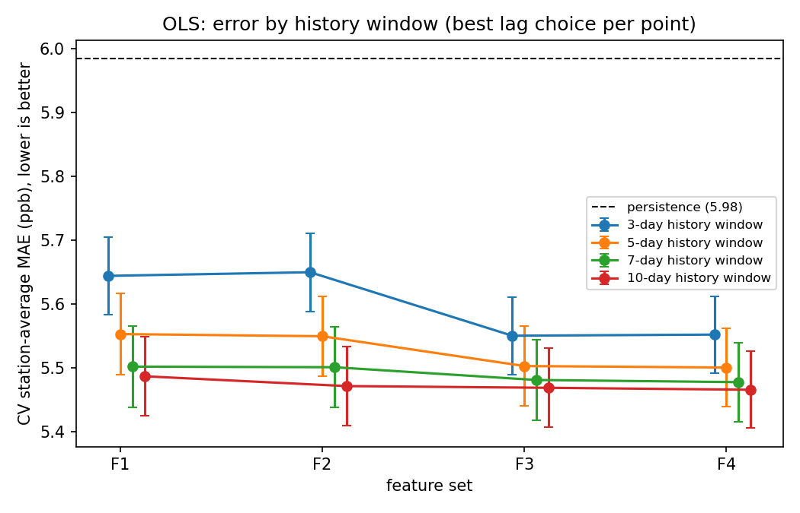
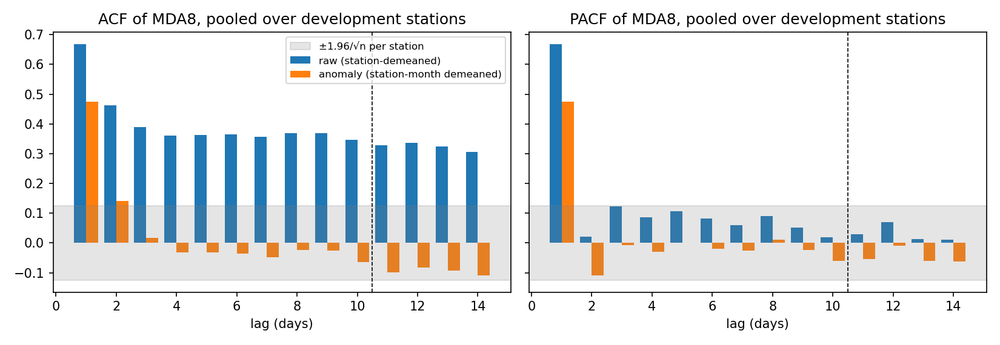
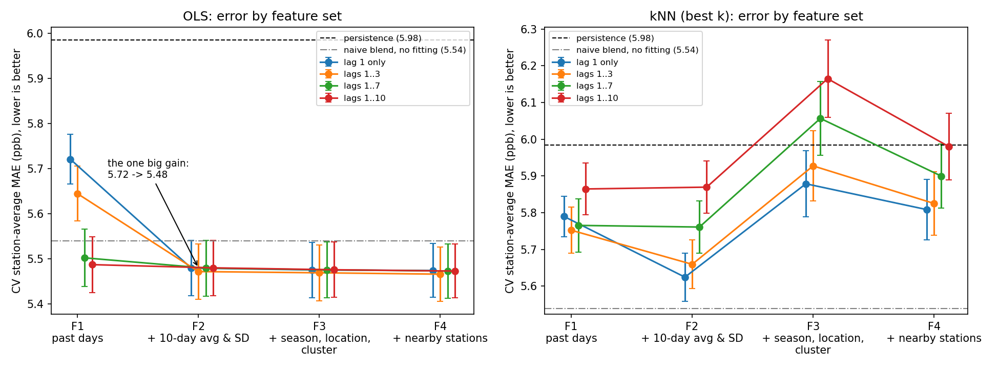
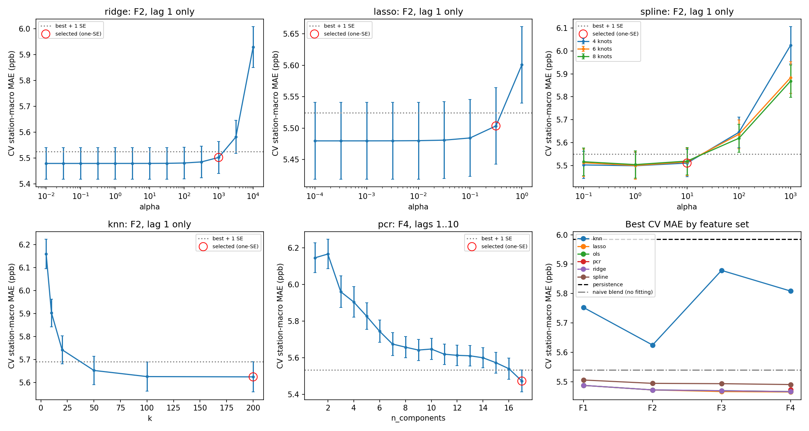
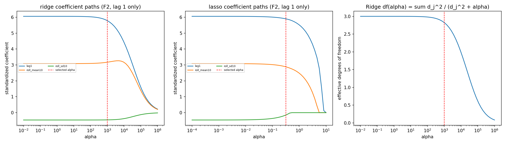
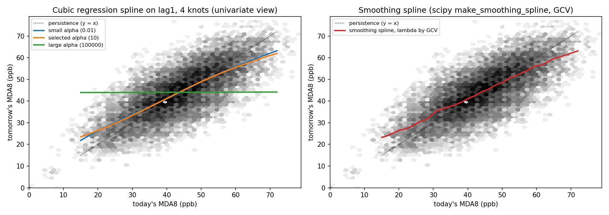
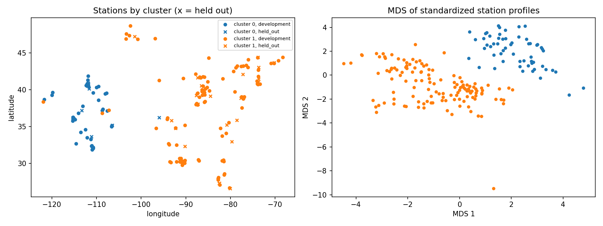

# Next-Day Ozone Forecasting: Key Findings (v2)

*Status as of 2026-11-06. Version 2 corrects version 1 (`key_findings.md`, kept unchanged) after an audit; section 10 lists what changed. Every number comes from cross-validation on the training data. The one-time final test has **not** been run yet.*

## The answer in one minute

- **Most of the skill comes from one simple rule:** average today's ozone with the past 10 days' average. With no fitting at all, that rule beats "tomorrow = today" by 7.4%.
- **Our main model, a straight-line regression (OLS), beats "tomorrow = today" by 8.4%** (5.48 vs 5.98 ppb). It adds about **1% on top of the simple rule** (5.48 vs 5.54), and wins in 20 of 25 cross-validation rounds.
- **Three inputs are enough:** today's ozone, the 10-day average, and the 10-day spread.
- **10 days of history works better than 3, 5 or 7.** (Version 1 used 7; see section 10.)
- **Nothing fancier helps consistently:** not Ridge, Lasso, splines, PCR or kNN, and not adding season, location or nearby-station features.

---

## 1. What we did

| Item | What it means |
|---|---|
| **Goal** | Predict tomorrow's ozone at each monitoring station from that station's recent history |
| **What we predict** | MDA8: the day's highest 8-hour average ozone, in parts per billion (ppb). The U.S. health limit is 70 ppb. |
| **Data** | EPA daily ozone file for 2024 (Jan 1 – Sep 30), 1,189 stations in the raw file |
| **Stations used** | 188 stations that report in every season: **150** to build models, **38** kept aside to test new locations |
| **History used** | The past **10 days** at each station |
| **Typical value** | 43 ppb on average (spread ±12 ppb). Only 0.7% of days go above 70 ppb. |
| **Baselines to beat** | **Persistence:** tomorrow = today. **Naive blend:** tomorrow = (today + 10-day average) / 2. Neither needs fitting. |
| **Score** | Average error in ppb at each station, then averaged over stations. **Lower is better.** |

---

## 2. Finding 1: the main skill is "pull today toward the recent average"

| Forecast rule | Fitted? | Average error (ppb) | Better than persistence |
|---|---|---|---|
| Persistence: tomorrow = today | No | 5.98 | — |
| 10-day average only | No | about 0.4 worse than persistence | — |
| **Naive blend:** (today + 10-day average) / 2 | No | 5.54 | 7.4% |
| **OLS main model** | Yes | **5.48** | **8.4%** |

**The main model, in plain words:**

> tomorrow ≈ 6.7 + **0.54** × today + **0.34** × (10-day average) − **0.15** × (10-day spread)

- Tomorrow is about half of today plus a third of the recent average.
- The weights add up to less than 1, so the forecast is **pulled toward the station's normal level**. A very high day is usually followed by a lower one, and a very low day by a higher one.
- The naive blend does the same thing with fixed 50/50 weights. That alone gets **88% of the improvement** over persistence. Fitting the weights adds the last 12%.

---

## 3. Finding 2: every regression model beats persistence by 6–8.5%, but not the blend by much

| Model (one-SE pick) | Average error (ppb) | Better than persistence | Better than naive blend |
|---|---|---|---|
| Persistence | 5.98 | — | — |
| Naive blend (no fitting) | 5.54 | 7.4% | — |
| **OLS, 3 inputs (main model)** | **5.48** | **8.4%** | **1.1%** |
| Ridge, 3 inputs | 5.50 | 8.0% | 0.7% |
| Lasso, 3 inputs | 5.50 | 8.0% | 0.7% |
| Spline, 3 inputs | 5.51 | 7.9% | 0.5% |
| PCR, all 17 components (= OLS on all features) | 5.47 | 8.5% | 1.2% |
| kNN, 3 inputs, k = 200 | 5.63 | 6.0% | worse |

**How sure are these differences?** Comparing models *within the same cross-validation round* (25 rounds):

| Comparison with the main model | Gap (ppb) | Rounds the main model wins | Consistent? |
|---|---|---|---|
| vs persistence | 0.50 | 25 / 25 | Yes |
| vs naive blend | 0.06 | 20 / 25 | Yes |
| vs kNN | 0.15 | 22 / 25 | Yes |
| vs best model using every feature (F4) | −0.01 (F4 slightly better) | 9 / 25 | **No: a tie** |
| vs PCR with all components | −0.01 | 11 / 25 | **No: a tie** |

---

## 4. Finding 3: 10 days of history beats 3, 5 or 7

We reran cross-validation with history windows of 3, 5, 7 and 10 days. Every window was scored on the same rows.

| History window | Best OLS error (ppb) |
|---|---|
| 3 days | 5.55 |
| 5 days | 5.50 |
| 7 days (version 1) | 5.48 |
| **10 days (now)** | **5.47** |

- **The longer the window, the better.** Most of the gain comes by 7 days, and 10 adds a little more.
- **We stopped at 10.** A separate check found 14 days only about 0.01 ppb better. A 14-day window would also leave the first days of the January test week without full history.
- **Why version 1 got this wrong:** it chose 7 days from the autocorrelation *after removing each station's monthly level* (chart below). On that view, single days beyond 2 add nothing. But longer windows help by **estimating the station's current level more steadily**, and that is exactly what the removal threw away.

---

## 5. Finding 4: what F1–F4 are, and what they show

Each feature set is the previous one plus one new block of inputs. Each is tried with 1, 3, 7 or 10 days of individual history.

| Set | Adds | Inputs (with 1 day) | Question it tests |
|---|---|---|---|
| **F1** | Individual past days: today, yesterday, … | today | Does recent history alone work? |
| **F2** | + 10-day average and 10-day spread (SD) | today, 10-day avg, 10-day SD | Does a summary of the recent period help? |
| **F3** | + time of year (sin/cos), latitude, longitude, West/East group | 8 inputs | Does *when* and *where* help? |
| **F4** | + today's average at the 5 nearest training stations | 9 inputs | Do nearby stations help? |

*Detail:* with all 10 days, F2 leaves out the 10-day average, because it is exactly the mean of the 10 days already included.

**OLS error (ppb):**

| | 1 day | 3 days | 7 days | 10 days |
|---|---|---|---|---|
| **F1** past days | 5.72 | 5.64 | 5.50 | 5.49 |
| **F2** + 10-day summary | **5.48** ← main | 5.47 | 5.48 | 5.48 |
| **F3** + when & where | 5.48 | 5.47 | 5.48 | 5.48 |
| **F4** + nearby stations | 5.47 | **5.47** ← best | 5.47 | 5.47 |

**How to read the graph**

- **Left (OLS): one big drop,** from F1 with today only (5.72) to F2 (5.48). That's the gain from knowing the recent level.
- **The recent level can come in either form.** F1 with all 10 days (red, 5.49) is about as good as F2.
- **After F2 the lines are flat.** F4 beats F2 by only 0.014 ppb, and wins just 16 of 25 rounds, which is a tie. The 10-day window already captures what season and location were adding.
- **Right (kNN): error goes up after F2.** kNN finds "similar days" by distance across all inputs, so adding place and date makes it match on those instead of ozone. This is the curse of dimensionality.
- The grey dash-dot line is the naive blend. Every linear model sits just below it; kNN never reaches it.

---

## 6. Finding 5: fancier methods add nothing here

| Method | What we saw | Why |
|---|---|---|
| **Ridge / Lasso** | Best accuracy equals OLS; Lasso removes no features. The one-SE pick (a strong penalty) is consistently 0.02 ppb *worse* than OLS. | 28,000 rows and few inputs, so there's nothing to fix by shrinking. Preferring a strong penalty costs a little. |
| **Spline** | The fitted curve is almost a straight line | Today → tomorrow is close to linear. (We only made `today` nonlinear.) |
| **PCR** | Error falls steadily from 6.15 (1 component) to 5.47 (all 17) | No component can be dropped. With all 17 it equals OLS. |
| **kNN** | Worst model (5.63); only works with a very large k | Averaging "similar days" is noisier than fitting a line |

**Why PCR and kNN are in the study.** Both are course methods, and each tests one idea. Neither was expected to win.

- **PCR (PCA, Class 5–6):** *can a few combined directions replace the correlated past days?* **No.**
- **kNN (Class 1–2, 20):** *is there a nonlinear pattern a line misses?* **No.**

Together with the near-straight spline, they show the relationship is close to linear. These are useful negative results.

---

## 7. Finding 6: where forecasting is easy and hard

Error in ppb by season and region (training data, cross-validation):

| Group | Persistence | Naive blend | Main model | Model vs persistence | Model vs blend |
|---|---|---|---|---|---|
| Winter (Jan–Feb) | 4.93 | 4.53 | 4.34 | 12.0% | 4.2% |
| Spring (Mar–May) | 5.54 | 5.10 | 5.06 | 8.7% | 0.8% |
| Summer (Jun–Aug) | 7.04 | 6.55 | 6.47 | 8.1% | 1.2% |
| Fall (Sep) | 5.80 | 5.51 | 5.54 | 4.5% | **−0.5%** |
| West stations | 4.49 | 4.18 | 4.11 | 8.5% | 1.7% |
| East stations | 6.70 | 6.20 | 6.12 | 8.7% | 1.3% |

- **Summer is hardest:** ozone is highest and swings most.
- **Winter is where fitting helps most** (4% better than the blend).
- **In September the fitted model is slightly worse than the blend.** It was fit mostly on other seasons.
- **Western stations are easier:** their ozone is higher but steadier.

**The two station groups.** Clustering (k-means) found two natural groups that match geography: **West** (higher, steadier ozone) and **East** (lower, more day-to-day change).

---

## 8. How we keep the final test fair

1. **Test weeks are hidden:** **Jan 11–17, May 1–7, Jul 22–28, Sep 11–17**. These are the same weeks as version 1, now written into the config so they can never be redrawn.
2. **A 10-day gap follows each test week.** Those days are not used for training, because their 10-day history would include test-week values.
3. **Test stations are hidden.** 38 stations (20%) never take part in building or tuning any model. They are the same stations as version 1.
4. **Models are frozen** with a fingerprint check before testing.
5. **Tuning never touches the test.** Cross-validation uses only training days and training stations, with the same 10-day gap after each validation block.
6. **Checked by code.** 14 tests on synthetic data check the leakage rules, and a rerun from scratch gives byte-identical results.

| Days in the study (Jan 1 – Sep 30) | Count |
|---|---|
| Training days | 196 |
| Test days (4 weeks) | 28 |
| Gap days after the test weeks | 40 |
| First 10 days (no full history yet) | 10 |

---

## 9. Data problems we fixed

| Problem | What we did |
|---|---|
| 40 stations have 2 instruments, so 2 readings on the same day | Kept the instrument with the most days (the two readings differ by a median of 1 ppb) |
| 2 days listed twice for "exceptional events" | Kept the as-measured value and flagged event days |
| "Observation Percent" goes up to 2400% | Treated as unreliable; not used |
| Many stations only run Mar–Jun | Kept only stations with data in every test week |
| October has only 80 stations | Left October out |

---

## 10. What changed from version 1, and why

| Issue found in the audit | Version 1 said | Version 2 says |
|---|---|---|
| History window too short | "Use at most 7 days; shorter windows are worse" | **10 days** is better than 3, 5 or 7. The window is now chosen by cross-validation, not by the autocorrelation chart. |
| Error bars misread | "Differences within one SE are not meaningful" | Within one SE means *close*, not *the same*. Gaps are now tested **round by round**. (With 7 days, F3/F4 were consistently better; with 10 days they tie.) |
| Weak baseline | "8% better than persistence" | Still true (8.4%), but a **no-fit blend gets 7.4%**. The model adds about 1% on top. |
| Rule change not disclosed | — | The primary-model rule was **revised after seeing CV results** (the first rule picked PCR with every component, which is just OLS). No test data was involved. |
| Cluster look-ahead not disclosed | — | The West/East label uses each station's whole series, including later days. The effect is small, but it's listed as a limit. |
| Claims broader than tested | "The relationship is linear"; "tests confirm no leakage" | Linear for today → tomorrow (the only spline tested). The tests use synthetic data. |

Version 1's numbers and figures are archived unchanged in `outputs_v1_7day/`.

---

## 11. Not done yet, and limits

**Still to do**
- [ ] Group agrees on the main model (OLS: today + 10-day average + 10-day spread)
- [ ] Run the one-time final test: `python run.py evaluate`
- [ ] Write the report and slides from the test results

**Limits to state in the report**
- **No weather data.** Temperature, sunlight and wind drive ozone; our models see only past ozone.
- **Small gain over a no-fit rule (about 1%).** The final test will show whether it holds.
- **One year only, no Oct–Dec.** "Fall" means September.
- **Not a pure forecast.** Training includes days after some test weeks. The final test also runs a forward-only check on September.
- **7 test days per season.** Per-season test results will be rough.
- **Year-round stations only.** Results may not apply to seasonal monitors.
- **Cluster label uses later days** (small look-ahead).

---

## Glossary

| Term | Meaning |
|---|---|
| **MDA8** | The day's highest 8-hour average ozone |
| **ppb** | Parts per billion |
| **Persistence** | Baseline forecast: tomorrow = today |
| **Naive blend** | Baseline forecast: tomorrow = (today + 10-day average) / 2, with no fitting |
| **Error (MAE)** | Average size of the forecast miss, in ppb |
| **History window** | How many past days the inputs cover (10 in our models) |
| **Feature set (F1–F4)** | Which inputs a model gets; each set adds one block (Finding 4) |
| **Cross-validation (CV)** | Repeatedly hide part of the training data, train on the rest, and score on the hidden part. Here: 25 rounds, each hiding different days *and* different stations |
| **Standard error (SE)** | How uncertain one model's average error is (about ±0.06 ppb here) |
| **One-SE rule** | Pick the simplest model whose error is within one SE of the best |
| **Round-by-round (paired) comparison** | Compare two models on exactly the same hidden data in each round, and count how often each wins. This is how we judge whether a gap is consistent. |
| **ACF / PACF** | How strongly today's value is linked to the value k days earlier (PACF: after accounting for the days in between) |
| **OLS / Ridge / Lasso** | Straight-line regression; Ridge and Lasso add a penalty that shrinks coefficients (Lasso can set some to zero) |
| **Spline** | A flexible curve instead of a straight line |
| **kNN** | Predict by averaging the k most similar past cases |
| **PCR** | Regression on a few combined "principal components" of the inputs |
